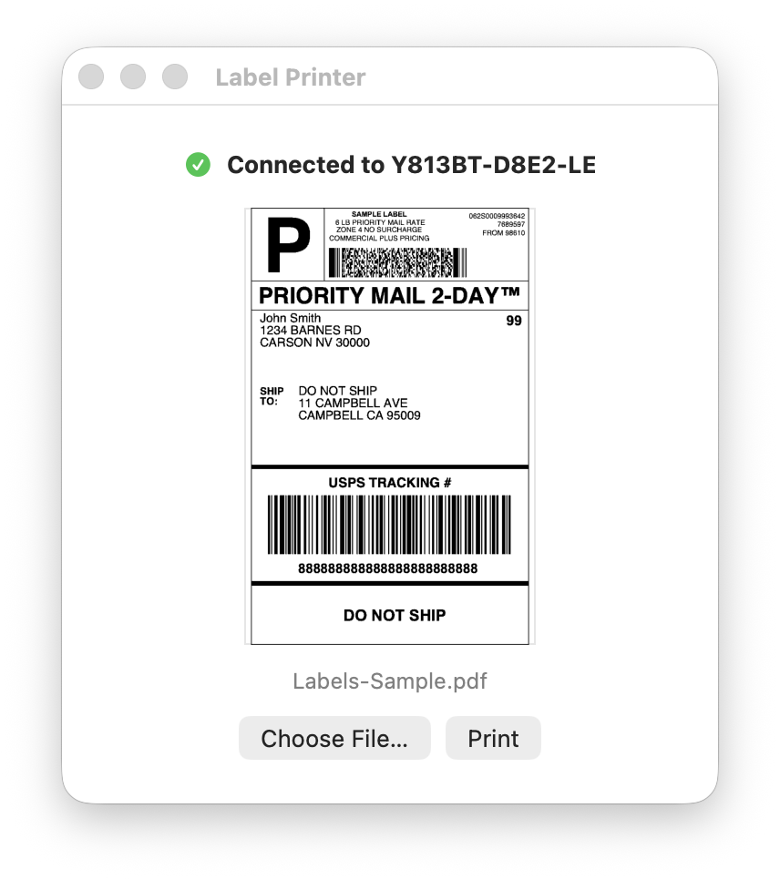

# Label Printer

Minimal macOS SwiftUI app that prints PDFs, images, or raw TSPL files to a Y813BT thermal label printer over Bluetooth LE (4x6 in labels).



## Build & run

```bash
make            # builds "Label Printer.app"
make run        # builds and launches it
make install    # builds and copies it to /Applications
make uninstall  # removes it from /Applications
make test       # runs the tests (no printer needed)
make icon       # regenerates Resources/AppIcon.icns from scripts/make-icon.swift
make clean      # removes build output and the app
```

Requires Xcode / Swift 6. You can also open `Package.swift` in Xcode.

## Use

1. Quit FlashLabel Pro (the printer only allows one BLE connection).
2. Launch the app and allow Bluetooth access. It looks for the printer automatically; click **Check Again** if it isn't found.
3. **Choose File…** (PDF, PNG/JPG/HEIC, or `.tspl`), check the preview, then **Print**. You can also drag a file onto the window or the Dock icon, or use **Open With › Label Printer** in Finder.

PDF pages print one label each. Landscape content is rotated to fit the portrait label.
`test-hello.tspl` is a small 40x30 mm text label for testing the connection.

## Tweaks

- Labels print inverted (white on black): set `invertBits = true` in `LabelRenderer.swift`.
- Label size, density and speed are in `LabelRenderer.swift` (`widthDots`, `heightDots`, `tsplLabel`).
- Garbled prints: set `preferFastWrite = false` in `PrinterManager.swift` to fall back to slower, acknowledged writes.
- BLE UUIDs and the printer name prefix are in `PrinterManager.swift`. See `y813bt_ble_notes.md` for the protocol details.

## License

MIT. See [LICENSE](LICENSE).
